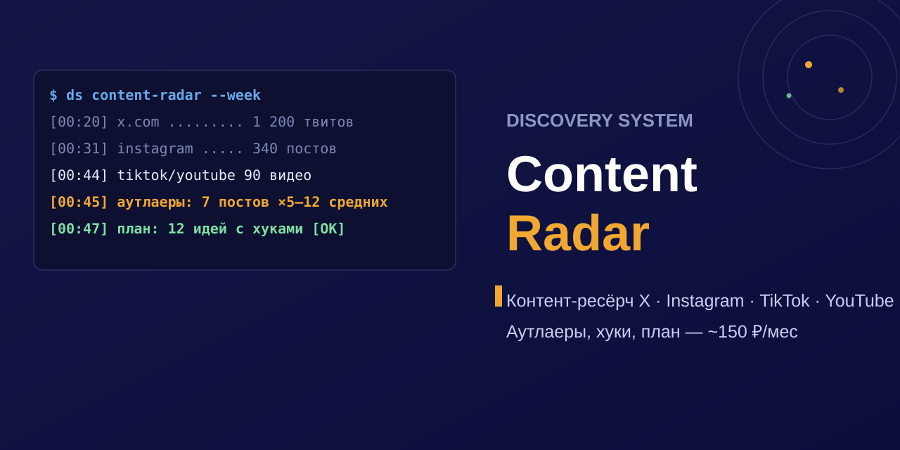

# ds_content-radar

**Discovery Content Radar**

<div align="center">

</div>

Контент-ресёрч по X, Instagram, TikTok и YouTube: сбор постов, поиск аутлаеров, разбор хуков и контент-план. Без Apify, без TubeLab, без подписок на Клода или GPT. Расходники — около 150 ₽ в месяц.

Инструмент из стекa [Discovery System](https://discovery-system.ru) — внедряем такие сборки малому бизнесу без зарубежных подписок.

Форк [bradautomates/head-of-content](https://github.com/bradautomates/head-of-content) (MIT) с заменёнными бэкендами. Формулы скоринга, структура отчётов и все 6 скиллов сохранены. Заменено то, что снимало с тебя деньги каждый месяц.

## Цена вопроса

| | Оригинал | Здесь |
|---|---|---|
| X/Twitter | Apify, $0.40/1000 твитов | twitterapi.io, $0.15/1000 |
| Instagram | Apify, $2.70/1000 постов | instaloader, бесплатно |
| TikTok | Apify, $3.70/1000 видео | yt-dlp, бесплатно |
| YouTube-аутлаеры | TubeLab, $39/мес | yt-dlp + локальный z-score, бесплатно |
| Анализ видео | Gemini free tier | Gemini free tier |
| **Итого** | **~$80/мес (~6 600 ₽)** | **~$1.8/мес (~150 ₽)** |

Расчёт для режима «3 прогона в неделю, 10 аккаунтов, 100 постов на аккаунт». Разово twitterapi.io даёт $1 на старте — первый месяц вообще бесплатный.

## Установка и использование

Шесть скиллов с префиксом **`ds_`**: готовые пакеты `*.skill` в корне репо — ставятся перетаскиванием в Claude Code, либо из папки `.claude/skills/`. В чате: «запусти ds_x-research по …».

```bash
git clone https://github.com/r0undm1dn1ghty-star/discovery-content-radar.git
cp -r discovery-content-radar/.claude/skills/* ~/.claude/skills/
# готовые пакеты: ds-пакеты *.skill лежат в корне репо
```

Все скиллы Discovery System — с префиксом **`ds_`**: `ds_pnl-check`, `ds_spiral-maturity`, `ds_geo-audit`, `ds_market-evidence`, `ds_warm-lead-parser`, `ds_content-radar`. Комплект и связка — [discovery-system.ru](https://discovery-system.ru).## Что внутри

Шесть скиллов для Claude Code / Cowork (папка `.claude/skills/` и пакеты `*.skill`):

- **x-research** — твиты отслеживаемых аккаунтов, аутлаеры по вовлечённости, темы, хэштеги
- **instagram-research** — посты и рилсы, аутлаеры, топ-5 на разбор хуков
- **tiktok-research** — видео, аутлаеры, тренды
- **youtube-research** — аутлаеры каналов-референсов, транскрипты, обложки
- **video-content-analyzer** — Gemini разбирает видео: хук, структура, CTA
- **content-planner** — гоняет все четыре ресёрча и собирает контент-план с плейбуками по платформам

Скоринг: X — bookmarks 4x, replies 3x, retweets 2x, quotes 2x, likes 1x. Instagram — лайки + 3×комменты + 0.1×просмотры. TikTok — лайки + 3×комменты + 2×шеры + 2×сейвы + 0.05×просмотры. YouTube — z-score с затуханием 5%/день. Аутлаер: выше среднего + 2 стандартных отклонения.

## Установка

```bash
git clone https://github.com/r0undm1dn1ghty-star/discovery-content-radar.git
cd discovery-content-radar
pip install requests python-dotenv yt-dlp youtube-transcript-api instaloader google-genai
cp .env.example .env
```

Три ключа в `.env`:

1. **XAPI_TOKEN** — [twitterapi.io](https://twitterapi.io), $1 бесплатных кредитов хватит на ~6 000 твитов
2. **GEMINI_API_KEY** — [aistudio.google.com/api-keys](https://aistudio.google.com/api-keys), free tier
3. Instagram — один раз `python -m instaloader --login ТВОЙ_НИК`, сессия сохранится

TikTok и YouTube ключей не требуют.

## Проверено

Живые прогоны 13.10.2026, из РФ, без VPN — детали в [BENCHMARK.md](BENCHMARK.md) и [EVAL.md](EVAL.md):

- TikTok @nasa: 15 видео → 2 аутлаера, скоринг и отчёт без правок
- YouTube @veritasium + @mkbhd: 50 видео → аутлаеры найдены верно (62M и 27M просмотров), транскрипты и обложки скачаны
- Instagram и X: пайплайн прогнан, требует твоей сессии/ключа

## Честные ограничения

- **Instagram** — самое хрупкое место. Анонимно instaloader ловит 429 (проверено: первый же запрос). Нужен session-файл своего аккаунта, не больше 30 постов на аккаунт и пары прогонов в неделю. Если нужен промышленный объём — Apify пока незаменим, там ротация прокси.
- **YouTube-аутлаеры** считаются внутри каналов, которые ты указал. TubeLab умел искать по всей базе YouTube по кейвордам — этой функции здесь нет. Если нужна, бесплатно закрывается YouTube Data API (10 000 юнитов в день).
- **TikTok** идёт через скрейп веб-версии: лайки, просмотры, комменты есть; шеры и сейвы часто пустые, подписчиков TikTok не отдаёт. Если TikTok поменяет сайт — `pip install -U yt-dlp`.
- Расходники бесплатны, но это не SLA. Для агентства с контент-маркетингом на потоке — норм. Для петабайтов данных — нет.

## Лицензия

MIT (наследована от оригинала, см. [LICENSE](LICENSE)). Автор оригинала — [bradautomates](https://github.com/bradautomates/head-of-content), у него на канале есть разбор идеи. Здесь переписан слой интеграций: три платформы идут без Apify, YouTube без TubeLab.
